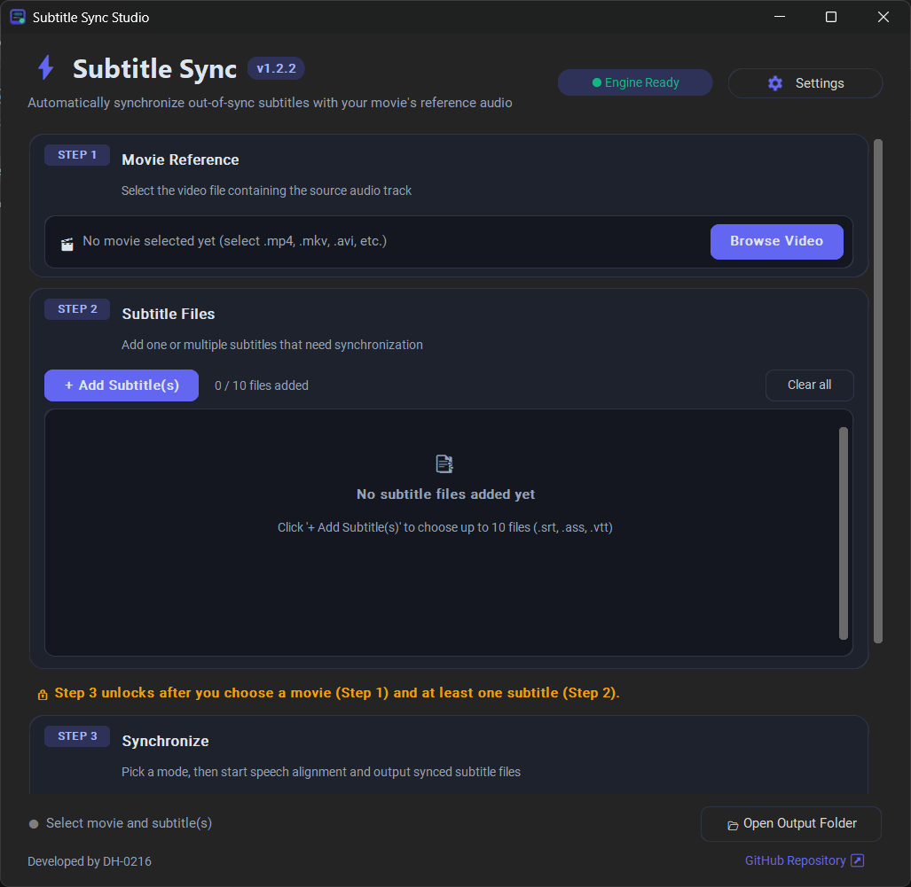

# Subtitle Sync Studio

<p align="center">
  
</p>

<p align="center">
  <b>A sleek, modern desktop app to automatically synchronize out-of-sync subtitles with your movie's reference audio.</b>
</p>

<p align="center">
  <a href="https://github.com/DH-0216/Subtitle-Sync/releases"></a>
  <a href="https://github.com/DH-0216/Subtitle-Sync/releases"></a>
  
  
  
  
  
  <a href="LICENSE"></a>
</p>

> [!IMPORTANT]
> **100% Free & Open Source:** Subtitle Sync Studio is completely free. If you paid or were charged money for this software on any marketplace (e.g. Microsoft Store, Gumroad, eBay, Etsy), you were scammed. Please request an immediate refund and download the official version for free from [GitHub](https://github.com/DH-0216/Subtitle-Sync).

---

## ✨ Features

- **3 Powerful Sync Modes**:
  - **Standard**: Fast 1-pass alignment for matching video and subtitle cuts.
  - **Smart**: 4-pass scoring algorithm (wide $\pm$15 min search, frame-rate drift fix with `--gss`, and alternate `auditok` speech detector) to fix subtitles that slowly drift (e.g. 23.976 vs 25 fps).
  - **Split sync**: Slices subtitles and audio into 2-minute parts to align different video cuts (WEBRip vs HDTV with commercial ads or recaps added/removed).
- **Audio Track Picker**: Detects multi-track video streams via ffprobe and allows picking the exact audio track (language, codec, channels) matching your subtitle.
- **Guided Step-by-Step Workflow**: Clear 3-step interface with intelligent lock states until video and subtitle files are loaded.
- **Batch Processing**: Add multiple subtitle files at once and synchronize them in sequence.
- **Modern UI & Dark Mode**: Sleek cards, clean typography, dynamic status indicators, and one-click Dark/Light mode toggle.
- **Embedded Activity Console**: View speech alignment progress in real time with detailed exit reports.
- **Direct Output Access**: Quickly open the destination folder containing your `.synced` subtitles with one click.
- **Standalone Portable App**: Available as a single double-clickable Windows `.exe` with zero installation required.

---

## 🚀 Quick Start (Download)

Download the latest version directly or pick your package from the [**GitHub Releases**](https://github.com/DH-0216/Subtitle-Sync/releases/latest) page:

<p align="center">
  <a href="https://github.com/DH-0216/Subtitle-Sync/releases/latest/download/SubtitleSync-Setup.exe">
    
  </a>
  &nbsp;&nbsp;
  <a href="https://github.com/DH-0216/Subtitle-Sync/releases/latest/download/SubtitleSync-Portable.exe">
    
  </a>
</p>

| Package | File | Direct Download | Description |
| :--- | :--- | :--- | :--- |
| **Windows Installer** *(Recommended)* | **`SubtitleSync-Setup.exe`** | [**Download Setup**](https://github.com/DH-0216/Subtitle-Sync/releases/latest/download/SubtitleSync-Setup.exe) | Standard setup wizard. Installs to Program Files, adds Start Menu & Desktop shortcuts, includes standard uninstaller, and sets up FFmpeg offline. |
| **Portable Version** | **`SubtitleSync-Portable.exe`** | [**Download Portable**](https://github.com/DH-0216/Subtitle-Sync/releases/latest/download/SubtitleSync-Portable.exe) | Standalone single `.exe`. Zero installation required. If FFmpeg is missing, prompts with an in-app 1-click auto-setup button. |

---

## 🛠️ Prerequisites

### For General Users (Downloading Releases)
> [!NOTE]
> **No prerequisites required!** If you download **`SubtitleSync-Setup.exe`** or **`SubtitleSync-Portable.exe`**, all engines (`ffmpeg.exe` and `ffsubsync.exe`) are bundled inside. You do not need to install Python, Node.js, or FFmpeg.

---

### For Developers (Cloning & Building from Source)
If you want to clone this repository and build the executables yourself, your machine needs:

1. **[Node.js](https://nodejs.org/)** (v18 or higher) & **npm**:
   - Required for the Electron framework, React frontend, and packaging.
2. **[Python](https://www.python.org/downloads/)** (v3.10 or higher) with pip:
   - Required by `build.bat` to compile the standalone `bin/ffsubsync.exe` (~43 MB) on the fly.
   - > [!IMPORTANT]
     > During Python installation on Windows, ensure you check the box: **"Add python.exe to PATH"**.
3. **Internet Connection** (on initial build):
   - To install npm dependencies, fetch Python build packages, and automatically download the official FFmpeg release.

---

## 💻 Running in Development Mode

```bash
# 1. Clone the repository
git clone https://github.com/DH-0216/Subtitle-Sync.git
cd Subtitle-Sync

# 2. Install dependencies
npm install

# 3. Ensure engine binaries exist in bin/ (optional, build.bat does this too)
# Place or allow build.bat to generate bin/ffmpeg.exe and bin/ffsubsync.exe

# 4. Launch the app in development mode
npm run dev
```

---

## 📦 Building the Executable & Installer

You can build both the standalone portable `.exe` and the standard Windows setup installer using the included 1-click builder:

1. Double-click **`build.bat`** (or run `.\build.bat` in terminal).
2. It will automatically:
   - Check Node.js and Python environments on your PATH.
   - Install required frontend dependencies (`npm install`).
   - Automatically download official `ffmpeg.exe` into `bin/` if missing.
   - Automatically compile the self-contained standalone `bin/ffsubsync.exe` (~43 MB) using PyInstaller if missing.
   - Bundle frontend assets with Vite & Electron.
   - Package the portable **`dist/SubtitleSync-Portable.exe`** and installer **`dist/SubtitleSync-Setup.exe`** with Electron Builder.
   - Create/update the double-click desktop shortcut (`Subtitle Sync.lnk`).

### 🛠️ Offline vs. Automated Engine Setup:
The application bundles FFmpeg and FFSubSync in `bin/` so end users have zero external dependencies:
- **Automated Setup (Default):** If either binary is missing in `bin/`, `build.bat` fetches `ffmpeg.exe` and compiles standalone `ffsubsync.exe` automatically. You can also run `build.bat --binaries` to only prepare engine binaries.
- **100% Offline Build:** If you already have `ffmpeg.exe` and a standalone `ffsubsync.exe`, simply place them in the `bin/` folder before running `build.bat`. It will detect them and skip downloads/compilation.

Or package manually via npm:

```bash
npm run package
```

---

## 📂 File Structure

```text
├── src/                     # Electron + React source code
│   ├── main/                # Electron main process (IPC, child processes, window management)
│   ├── preload/             # Electron preload context bridge
│   └── renderer/            # React 18 + Tailwind CSS frontend UI
│       ├── components/      # Step cards, modals, ActivityConsole, etc.
│       ├── types/           # Subtitle & synchronization type definitions
│       └── utils/           # Analysis, formatters & recommendation engine
├── electron.vite.config.ts  # Vite configuration for main, preload and renderer
├── package.json             # App manifest, dependencies & electron-builder targets
├── app_icon.ico             # Windows multi-resolution icon
├── app_icon.png             # High-resolution icon preview
├── app_preview.png          # Desktop application preview screenshot
├── LICENSE                  # GNU General Public License v3.0
├── build.bat                # All-in-One builder (Electron Builder + engine binary management)
├── bin/                     # Standalone engine binaries (ffmpeg.exe, ffsubsync.exe)
├── dist/                    # Compiled distribution output folder
│   ├── SubtitleSync-Setup.exe            # Standard Windows Setup Installer
│   └── SubtitleSync-Portable.exe         # Standalone portable application
└── README.md                # Project documentation
```

---

## 📄 Output Files

Synchronized subtitle files are automatically saved in the same directory as the original subtitle files with a `.synced` suffix:
- Original: `Movie.Title.srt`
- Synchronized: `Movie.Title.synced.srt`

---

## 🙏 Credits & Third-Party Notices

Subtitle Sync Studio relies on the following open-source projects:

- **[FFmpeg](https://ffmpeg.org/)**: Multimedia framework used to extract and analyze audio tracks from video files. FFmpeg is licensed under the [GNU LGPL / GPL](https://ffmpeg.org/legal.html). Its source code can be downloaded from [ffmpeg.org/download.html](https://ffmpeg.org/download.html).
- **[ffsubsync](https://github.com/smacke/ffsubsync)**: Speech-to-subtitle alignment engine powered by [ffsubsync](https://github.com/smacke/ffsubsync) (MIT License).
- **[CustomTkinter](https://github.com/TomSchimansky/CustomTkinter)**: Desktop UI interface built with [CustomTkinter](https://github.com/TomSchimansky/CustomTkinter) (Creative Commons Zero / MIT License).

---

## 📜 License

This project is licensed under the **GNU General Public License v3.0 (GPLv3)** — see the [LICENSE](LICENSE) file for the full text.

- **Freedom to Use & Modify**: You are free to run, study, modify, and share this software.
- **Copyleft Protection**: Any redistributed copies or derivative works must also be open source under the exact same GPLv3 license and provide complete source code.
- **No Warranty**: Provided as-is without warranties of any kind.
