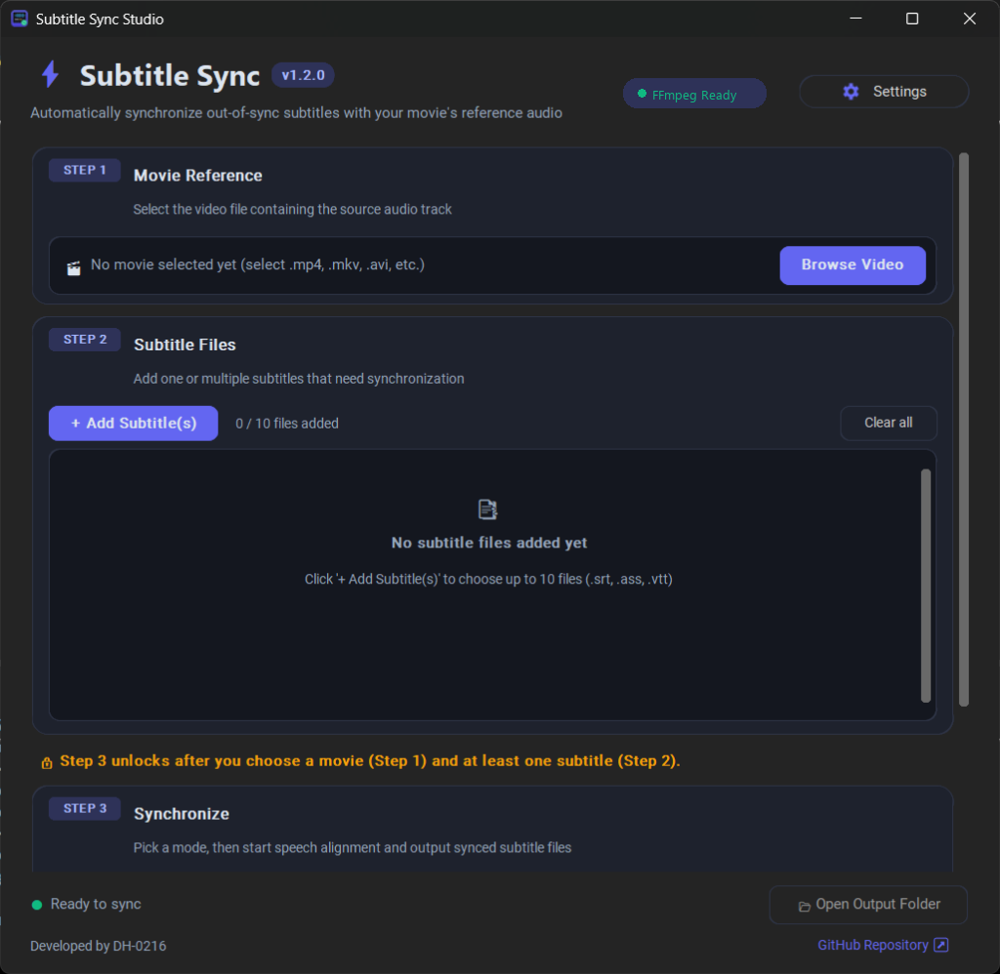

# Subtitle Sync Studio

<p align="center">
  
</p>

<p align="center">
  <b>A sleek, modern desktop app to automatically synchronize out-of-sync subtitles with your movie's reference audio.</b>
</p>

<p align="center">
  <a href="https://github.com/DH-0216/Subtitle-Sync/releases"></a>
  <a href="https://github.com/DH-0216/Subtitle-Sync/releases"></a>
  
  
  
  
  <a href="LICENSE"></a>
</p>

> [!IMPORTANT]
> **100% Free & Open Source:** Subtitle Sync Studio is completely free. If you paid or were charged money for this software on any marketplace (e.g. Microsoft Store, Gumroad, eBay, Etsy), you were scammed. Please request an immediate refund and download the official version for free from [GitHub](https://github.com/DH-0216/Subtitle-Sync).

---

## ✨ Features

- **3 Powerful Sync Modes**:
  - **Standard**: Fast 1-pass alignment for matching video and subtitle cuts.
  - **Smart**: 4-pass scoring algorithm (wide $\pm$15 min search, frame-rate drift fix with `--gss`, and alternate `auditok` speech detector) to fix subtitles that slowly drift (e.g. 23.976 vs 25 fps).
  - **Split sync**: Slices subtitles and audio into 2-minute parts to align different video cuts (WEBRip vs HDTV with commercial ads or recaps added/removed).
- **Audio Track Picker**: Detects multi-track video streams via ffprobe and allows picking the exact audio track (language, codec, channels) matching your subtitle.
- **Guided Step-by-Step Workflow**: Clear 3-step interface with intelligent lock states until video and subtitle files are loaded.
- **Batch Processing**: Add multiple subtitle files at once and synchronize them in sequence.
- **Modern UI & Dark Mode**: Sleek cards, clean typography, dynamic status indicators, and one-click Dark/Light mode toggle.
- **Embedded Activity Console**: View speech alignment progress in real time with detailed exit reports.
- **Direct Output Access**: Quickly open the destination folder containing your `.synced` subtitles with one click.
- **Standalone Portable App**: Available as a single double-clickable Windows `.exe` with zero installation required.

---

## 🚀 Quick Start (Download)

Download the latest version directly or pick your package from the [**GitHub Releases**](https://github.com/DH-0216/Subtitle-Sync/releases/latest) page:

<p align="center">
  <a href="https://github.com/DH-0216/Subtitle-Sync/releases/latest/download/SubtitleSync-Setup.exe">
    
  </a>
  &nbsp;&nbsp;
  <a href="https://github.com/DH-0216/Subtitle-Sync/releases/latest/download/SubtitleSync-Portable.exe">
    
  </a>
</p>

| Package | File | Direct Download | Description |
| :--- | :--- | :--- | :--- |
| **Windows Installer** *(Recommended)* | **`SubtitleSync-Setup.exe`** | [**Download Setup**](https://github.com/DH-0216/Subtitle-Sync/releases/latest/download/SubtitleSync-Setup.exe) | Standard setup wizard. Installs to Program Files, adds Start Menu & Desktop shortcuts, includes standard uninstaller, and sets up FFmpeg offline. |
| **Portable Version** | **`SubtitleSync-Portable.exe`** | [**Download Portable**](https://github.com/DH-0216/Subtitle-Sync/releases/latest/download/SubtitleSync-Portable.exe) | Standalone single `.exe`. Zero installation required. If FFmpeg is missing, prompts with an in-app 1-click auto-setup button. |

---

## 🛠️ Prerequisites

> [!NOTE]
> If you downloaded **`SubtitleSync-Setup.exe`** or **`SubtitleSync-Portable.exe`**, FFmpeg is handled automatically! You do not need to install it manually.

Subtitle synchronization uses **`ffmpeg`** to extract and analyze speech audio from your video files. If you are **running from source** or prefer installing it manually on Windows:

1. Open **PowerShell** and run:
   ```powershell
   winget install ffmpeg
   ```
   *(Note: If prompted with multiple package options, run `winget install Gyan.FFmpeg`)*
2. Verify that it worked:
   ```powershell
   ffmpeg -version
   ```

*(Alternative: You can also download manually from [ffmpeg.org/download.html](https://ffmpeg.org/download.html) and add it to your system `PATH`)*

---

## 💻 Running from Source

If you prefer running directly with Python:

```bash
# 1. Clone the repository
git clone https://github.com/DH-0216/Subtitle-Sync.git
cd Subtitle-Sync

# 2. Install dependencies
pip install customtkinter ffsubsync pillow

# 3. Launch the app
python subsync_modern.py
```

---

## 📦 Building the Executable & Installer

You can build both the standalone portable `.exe` and the standard Windows setup installer using the included 1-click builder:

1. Double-click **`build.bat`**.
2. It will automatically:
   - Check and verify required build dependencies.
   - Package the portable **`dist/SubtitleSync-Portable.exe`** with PyInstaller.
   - Compile **`dist/SubtitleSync-Setup.exe`** (requires `ffmpeg.exe` to bundle for offline end-user installation).
   - Create a double-click shortcut (`Subtitle Sync.lnk`).

### 🛠️ Offline vs. Automated FFmpeg Setup for Installer:
The setup installer bundles FFmpeg so end users don't need to configure PATH manually. For developers compiling the installer from source:
- **100% Offline Build:** Place your own `ffmpeg.exe` into the `bin/` directory (or have FFmpeg installed on your system). `build.bat` will detect and bundle it without touching the internet.
- **Automated Setup:** If `bin/ffmpeg.exe` is missing, `build.bat` will ask if you'd like to download it automatically. You can also run **`get_ffmpeg.bat`** at any time to automatically fetch and place `ffmpeg.exe` into `bin/`.

Or build the portable `.exe` manually in your terminal:

```bash
pyinstaller --noconsole --onefile --clean --name "SubtitleSync" --icon "app_icon.ico" --add-data "app_icon.ico;." --collect-all customtkinter subsync_modern.py
```

---

## 📂 File Structure

```text
├── subsync_modern.py        # Application entry point launcher
├── src/                     # Modular core package
│   ├── app.py               # Main UI window, step cards & batch queue
│   ├── constants.py         # Version, color themes & sync mode settings
│   ├── dialogs.py           # FFmpeg setup, Update & Settings dialogs
│   ├── engine.py            # Standard, Smart & Split sync execution engines
│   ├── media.py             # FFmpeg/ffprobe detection & audio track probing
│   ├── settings.py          # User settings persistence
│   ├── srt_tools.py         # Subtitle parsing, math & audio windowing
│   └── utils.py             # Titlebar dark theming, icons & paths
├── installer.iss            # Inno Setup Windows installer script
├── create_icon.py           # Icon generation script
├── app_icon.ico             # Windows multi-resolution icon
├── app_icon.png             # High-resolution icon preview
├── app_preview.png          # Desktop application preview screenshot
├── LICENSE                  # GNU General Public License v3.0
├── build.bat                # 1-click builder script (Portable & Installer)
├── get_ffmpeg.bat           # Helper to fetch/copy ffmpeg.exe into bin/
├── bin/                     # Local binaries folder (offline ffmpeg.exe)
├── dist/                    # Compiled distribution output folder
│   ├── SubtitleSync-Setup.exe            # Standard Windows Setup Installer
│   └── SubtitleSync-Portable.exe         # Standalone portable application
└── README.md                # Project documentation
```

---

## 📄 Output Files

Synchronized subtitle files are automatically saved in the same directory as the original subtitle files with a `.synced` suffix:
- Original: `Movie.Title.srt`
- Synchronized: `Movie.Title.synced.srt`

---

## 🙏 Credits & Third-Party Notices

Subtitle Sync Studio relies on the following open-source projects:

- **[FFmpeg](https://ffmpeg.org/)**: Multimedia framework used to extract and analyze audio tracks from video files. FFmpeg is licensed under the [GNU LGPL / GPL](https://ffmpeg.org/legal.html). Its source code can be downloaded from [ffmpeg.org/download.html](https://ffmpeg.org/download.html).
- **[ffsubsync](https://github.com/smacke/ffsubsync)**: Speech-to-subtitle alignment engine powered by [ffsubsync](https://github.com/smacke/ffsubsync) (MIT License).
- **[CustomTkinter](https://github.com/TomSchimansky/CustomTkinter)**: Desktop UI interface built with [CustomTkinter](https://github.com/TomSchimansky/CustomTkinter) (Creative Commons Zero / MIT License).

---

## 📜 License

This project is licensed under the **GNU General Public License v3.0 (GPLv3)** — see the [LICENSE](LICENSE) file for the full text.

- **Freedom to Use & Modify**: You are free to run, study, modify, and share this software.
- **Copyleft Protection**: Any redistributed copies or derivative works must also be open source under the exact same GPLv3 license and provide complete source code.
- **No Warranty**: Provided as-is without warranties of any kind.
